# Process log

Running record of what we tried, what happened, and why we changed course. Newest entries at the bottom.
Each entry: date, what we tried, result (with image), decision.

---

## 2026-11-24 — Entry 0: first feasibility test (T4, gsplat)

**Tried.** 40k Gaussians scattered randomly in depth (2–8 units) inside the secret camera's view frustum,
then optimized (600 Adam steps, L1) so the render from the secret camera matches a smiley + "CS180 SPLAT".

**Result.** The secret view is near-perfect (L1 ≈ 0). But the off-views at 0.15 rad and 0.6 rad are *not*
scattered specks: they show a smeared yellow blob that still reads as "a smiley seen from the side".

*Left to right: target, secret view, orbit 0.15 rad, orbit 0.6 rad.*

**Why.** Only the secret view was supervised, so the Gaussians were free to grow large and opaque;
large flat-colour regions fill a coherent cone of space, which projects to a blob from nearby views.

**Decision.** Make "what does it look like from *other* angles" the go/no-go test, not the secret view:
- cap each Gaussian's size to ~1.5 secret-view pixels at its own depth (keeps them specks);
- spread depth log-uniformly over a range much larger than the viewer's movement (3–30 units);
- only place Gaussians on "ink" pixels (targets with transparency);
- compare a flat-colour target against line art and text;
- (Illusion3D-inspired) jitter the secret camera during the fit to control the reveal-zone width.

## 2026-11-24 — Entry 1: web viewer (three.js + Spark 2.4)

**Tried.** A static viewer: fly controls, "Show me the spot" (2.5 s eased fly-to the secret pose),
a warmer/colder meter, a scene picker. Data contract: standard 3DGS PLY + `scene.json` with OpenCV
camera-to-world matrices; the viewer converts with `c2w_three = c2w_cv @ diag(1,-1,-1,1)`.

**Finding.** Browser splat renderers do not filter splats like gsplat does. Spark's default adds a
0.3 px blur *and then dims opacity to compensate*, which darkens isolated ~1 px specks by about 27%.
We switched to `preBlurAmount 0.3, blurAmount 0` (gsplat "classic" equivalent), turned off Spark's
level-of-detail (which would merge tiny specks), and stored positions at full precision. On the CPU test
scenes the secret view is crisp in the browser, and a 1M-Gaussian scene (68 MB PLY) rendered fine on a laptop.

**Decision.** Keep the classic filter so what we optimize in Python is what people see in the browser.

## 2026-11-24 — Entry 2: option A with speck-size caps (experiment A1)

**Tried.** 135k Gaussians on the eye's ink pixels, depth log-uniform in 3–30 units, each Gaussian capped
at 1.5 secret-view pixels, 1000-step fit (L1 + 0.2·D-SSIM). Variant: Illusion3D-style scheduled camera
jitter (radius ramps 0 → 0.3 units, about 3% of the viewing distance).

**Result.** Secret view SSIM 0.997. Off-views are now specks, not blobs — but the cloud reads as the
picture *extruded* into a tube, which gives the trick away from the side.
Rows (after the target): sideways steps of 0, 1, 2, 5, 10, 20% of the distance / orbits of 0, 3, 10, 25, 60, 120°.

Jitter widens the reveal zone a lot (SSIM to the hidden image at a 2% step: 0.74 → 0.95; at 5%: 0.62 → 0.89),
for a tiny cost at the exact spot (0.997 → 0.96):

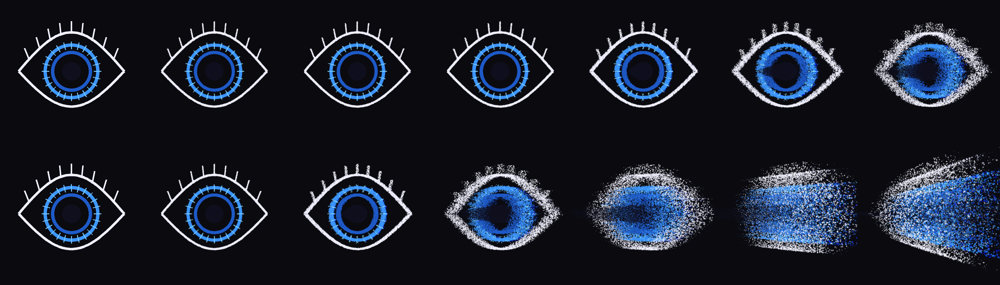

| sideways step | 0% | 1% | 2% | 5% | 10% | 20% |
| --- | --- | --- | --- | --- | --- | --- |
| no jitter | 1.00 | 0.81 | 0.74 | 0.62 | 0.53 | 0.46 |
| jitter 0.3 | 0.96 | 0.96 | 0.95 | 0.89 | 0.81 | 0.72 |

**Why.** To survive camera jitter the optimizer fades out specks far from the middle depth (they have
the most parallax), so the cloud flattens toward a billboard. Jitter trades *surprise* for *discoverability*.

**Decision.** (1) Fix the extrusion: only place specks where each ray passes through a *ball* around the scene
centre, so from any other angle the cloud is a round ball of coloured dust (experiment A2).
(2) Keep jitter as the reveal-zone knob and report the tradeoff as a result, not hide it.

## 2026-11-24 — Entry 3: "ball" placement, and a better reveal metric (experiment A2)

**Tried.** Instead of a fixed depth slab, each pixel ray only gets specks where it passes through a ball
around the scene centre, hoping the side views would look like a round cloud of dust.

**Result.** Barely different from the slab. From the side it still reads as streaks of the picture:

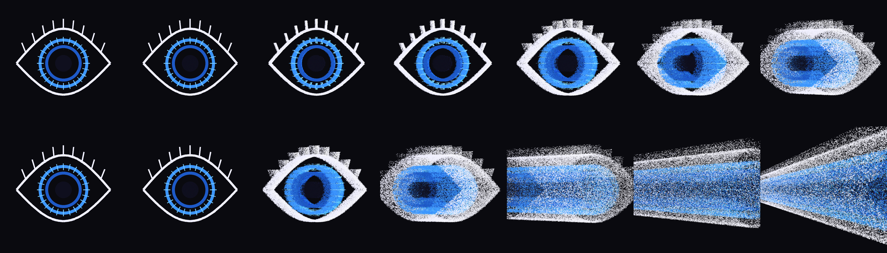

**Why (the real lesson).** Orbiting around the vertical axis never changes which *row* of the picture a
speck belongs to — rows stay rows, only their horizontal order scrambles. Any cloud built along the secret
camera's rays has this property; real anamorphic street art does too (you see coloured fragments, not noise).
Text and big flat shapes keep the most row structure, so they stay partly readable from the side.

**Metric fix.** SSIM to the hidden image stayed around 0.5 even at 120°, because the matching dark
background counts as "similar". We switched to normalised cross-correlation (NCC) over the picture's region
only: 1.0 at the secret spot, near 0 when scrambled.

| recognisability at a sideways step of | 1% | 2% | 5% | 10% | 50% |
| --- | --- | --- | --- | --- | --- |
| eye | 0.85 | 0.70 | 0.46 | 0.31 | 0.14 |
| eye, trained with camera jitter | 1.00 | 0.99 | 0.90 | 0.72 | 0.16 |

**Decision.** Stop tuning option A's look; it is the "dust cloud" baseline and the reveal-zone study.
Move to the real scene. New idea from this: *projection painting* — recolour the garden's own Gaussians by
projecting the picture from the secret viewpoint, like Felice Varini painting across buildings. From other
angles you see painted fragments on leaves, gravel and the table. That is a training-free baseline for option B,
and the starting point for its optimization.

## 2026-11-24 — Entry 4: two pictures in one cloud (two-view anamorphosis)

**Feedback that triggered it.** "The dots just form a cylinder; it doesn't seem that impressive." Fair: in option A
every speck lies on one of the secret camera's lines of sight, so from the side you see that bundle of lines.

**Idea (from entry 3's "rows stay rows").** If the side view is structured anyway, make it show a *second picture*.
Put a speck only where camera A sees ink in picture A **and** camera B (90° around) sees ink in picture B — the
intersection of the two cones of sight (a visual hull, as in space carving / Shadow Art). It is stereo triangulation
run backwards: we choose 3D points so their two projections land where we want. Each speck gets SH degree-1 colour so
it can show A's colour toward A and B's toward B; a joint gsplat fit on both views cleans up.

**Result.** Test drawings: ink coverage 94–100%, SSIM 0.98–1.00 at both spots. With public-domain paintings
(320k specks, square crops so both pictures cover the same rows): coverage 98%, SSIM 0.93 (Great Wave) / 0.90
(Starry Night), and every in-between angle is genuinely scrambled — the "tube" is gone.
Columns: target, 0°, 10°, 25°, 45° / 65°, 80°, 90°, target B, 135°.

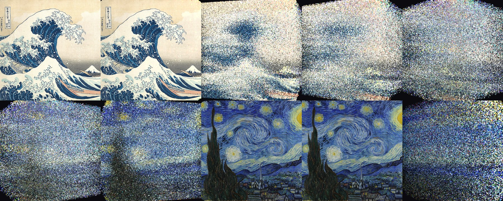

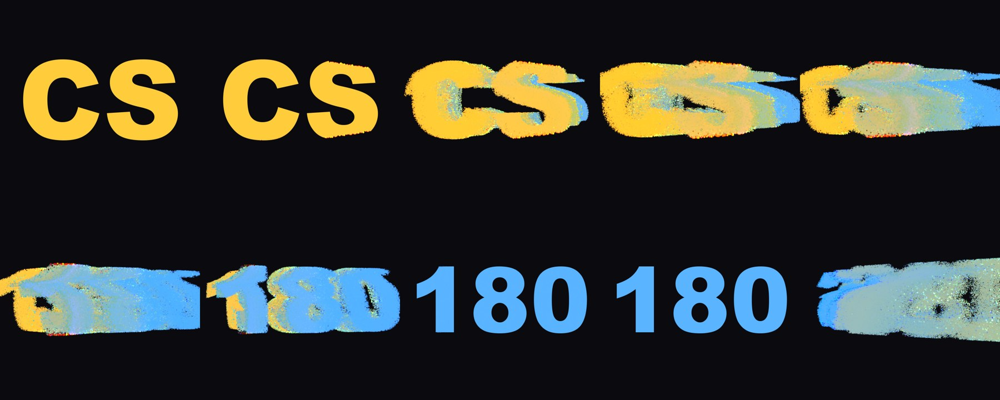

**Decision.** Two-view becomes the headline of the synthetic gallery. Option A stays as the simple baseline and the
reveal-zone study.

## 2026-11-24 — Entry 5: hiding a painting in a real garden (tried, then dropped)

**Tried.** Trained a 3DGS of the Mip-NeRF 360 *garden* (gsplat MCMC, 600k Gaussians, 20k steps; held-out
PSNR 26.7 dB) and hid *Girl with a Pearl Earring* in it, seen from a secret spot above the table.
1. *Projection painting* (recolour the Gaussians the secret camera sees on the picture's pixels): the portrait
   is blurry (the table is a few large Gaussians that can each hold one colour), and the painting's dark background
   stains the table from every view (held-out views 20.9 dB vs. the untouched garden).

   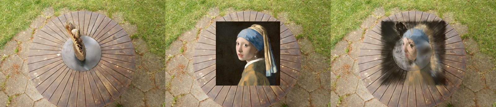

2. *Painting + optimization* (keep normal views close to the original renders, ComplicitSplat-style): the secret
   view becomes near-perfect (SSIM 0.998) but normal views are still visibly changed (23.2 dB).
3. *Decals* (Felice Varini-style: new thin paint discs laid on the surfaces using the secret view's depth map and
   normals; the garden itself frozen; figure cut out of its background): the garden stays intact (30.2 dB) and the
   portrait is crisp from the spot (SSIM 0.96) — but paint discs on the table's rim show as streaks from the side.

   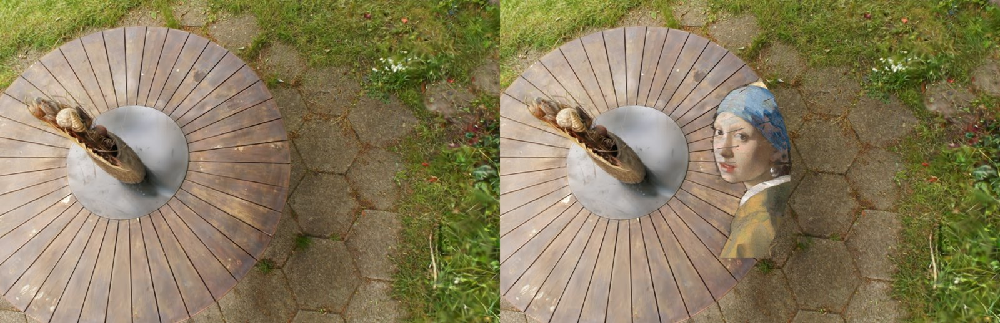
   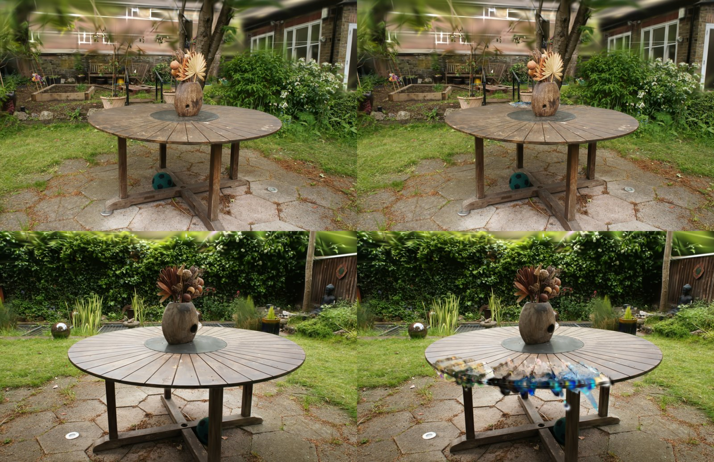

**Why we dropped it.** Even when it works, a still of the secret view looks like a picture pasted onto a table:
physical paint can already do this, so there is no "how is that possible?" moment. The multi-painting clouds
(entry 4) have that moment. A view-dependent "invisible ink" version (garden untouched from every normal view) is
possible in a radiance field but would be a project of its own.

**Decision.** Focus on the multi-painting clouds and measure them properly: how close two secret spots can be
(separation), how many paintings one cloud can hold (capacity), why angle-dependent colour is needed (SH ablation),
and how many specks are needed (budget).

## 2026-11-24 — Entry 6: three paintings in one cloud

**Tried.** The same carving with three cameras: front (The Great Wave), side at 90° (The Starry Night) and from
above at 80° (Girl with a Pearl Earring). SH degree 1 has exactly three directional terms, so one speck can show a
different colour toward three roughly perpendicular directions. 600k specks.

**Result.** Coverage 99% for all three; SSIM 0.96 / 0.95 / 0.95 at the three spots; everything in between is noise.
Top row: each target and its render; bottom row: in-between views.

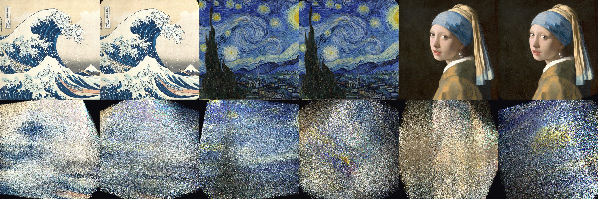

## 2026-11-24 — Entry 7: how far does it go? (four studies)

Baseline: The Great Wave + The Starry Night, 90° apart, 500k specks, SH degree 1, 1000 steps; change one thing at a time.

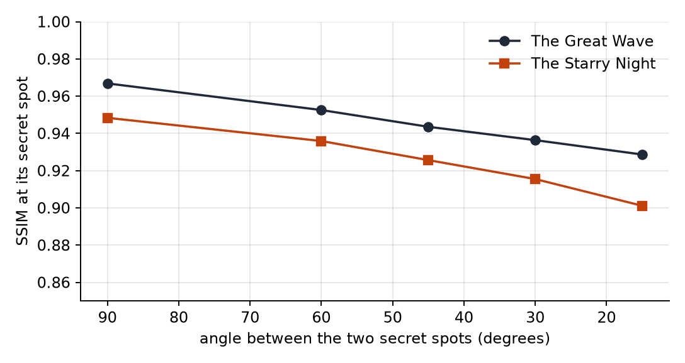 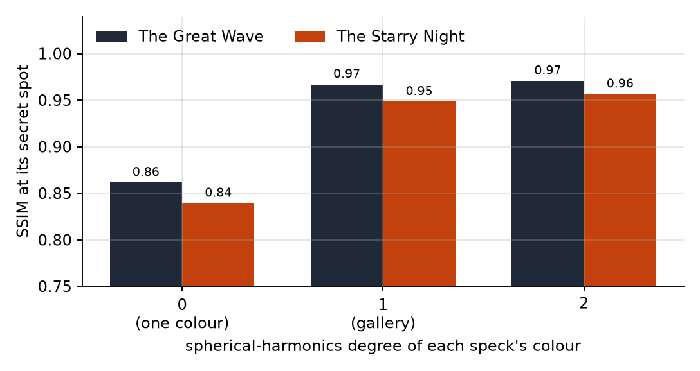
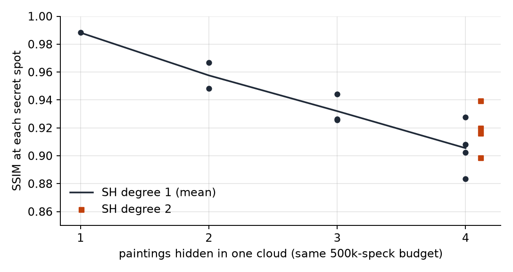 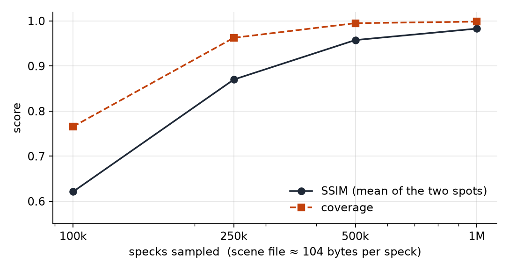

| Study | Finding |
| --- | --- |
| Separation (90 → 15°) | SSIM at the spots falls only from 0.97/0.95 to 0.93/0.90. At 15° the reveal zones touch: between the spots one painting dissolves into the other. |
| Colour model (SH 0/1/2) | One colour per speck caps both at ~0.85 (0.86/0.84); SH 1 gives 0.97/0.95; SH 2 adds < 0.01. |
| Capacity (1–4 paintings) | ~0.03 SSIM per extra painting at a fixed budget (0.99 → ~0.91). No cliff at four: front and back are opposite directions, which the linear SH term separates. SH 2 helps by ~0.01. |
| Budget (100k → 1M) | 100k leaves holes (coverage 0.77, SSIM 0.62); 500k is the knee (0.96 mean, ~50 MB); 1M gains only 0.02. |

**Surprise.** We expected four paintings to break SH degree 1 ("only three directional terms"). It doesn't, because
the fourth view is the first one reversed.

## 2026-11-24 — Entry 8: rubric review and article rewrite

**Tried.** Had a separate review agent grade the article and gallery against the course rubric and the staff
guidance (positioning, creative process, iterating with agents), and cross-check every number against the result
files. Scores out of 10: positioning 5, iterating with agents 4, scholarship 6, credibility 6.

**Found.** The closest prior work (suspended-object portraits, lenticular prints, wire art) was missing or buried at
the end. Method figures still used test drawings. Several numbers had drifted from the files: a "second version" at
1500 steps that no scene file backs; coverage "0.98 to 0.995 in every scene". And the single-painting section
described the log-uniform depth slab, although every painting cloud uses `--volume ball`.

**Decisions.** Asked for by the user: delete the browser section; trim toward one clear expert voice; the hero video
left to our judgement. Proposed by the review and the agent, and accepted:
- A positioning table up front (anamorphosis → suspended objects → lenticular → Shadow Art → wire art → visual
  anagrams → this project). Article about 17% shorter overall.
- Measure the reveal zone on paintings, not drawings: single-painting clouds of *Girl with a Pearl Earring* and
  *The Great Wave*, sharp vs. jitter (`hips.figures reveal_paintings`). At a 5% sideways step, jitter takes the Pearl
  Earring from 0.77 to 0.98 NCC. It costs the Wave 0.98 → 0.89 at the spot (fine detail can't survive the wobble).
- Replace the test-drawing figures with painting ones: the Mona Lisa tube (Solo), and the 15° separation strip.
- A hero video. The user first said it wasn't needed, then left it to judgement. We kept it because motion shows
  the snap far better than stills (`hips/tour_video.py`, Trio cloud, 3.6 MB).
- A "How the idea evolved" section and an honest note on how the agents were used.
- A second review pass caught overclaims in that note (e.g. "every number checked" while two claims were still
  untraced); we rewrote it.
- Stopped the Colab T4 after copying all needed outputs locally (`results/vm_eval`, `results/tour`).
- Correction to entry 7. The explanation "front and back are opposite, so the linear term separates them for free" is
  wrong, and so was the prediction. Degree-1 colour is a + g·d: four unknowns per channel. Any four non-coplanar
  directions are exactly solvable, and the colours at the spots are exact (numpy check: residual ~1e-16). So the
  algebraic limit is four paintings, not three; the "three directional terms" count forgot the base colour. The
  measured slope (~0.02–0.03 SSIM per painting; coverage 0.999 → ~0.98) is not a colour-model limit.
