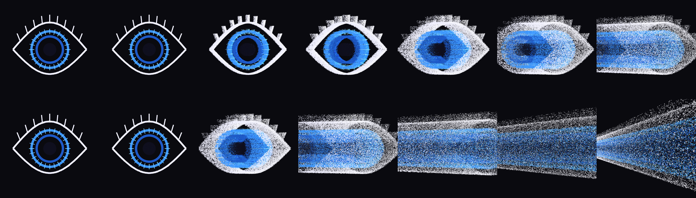
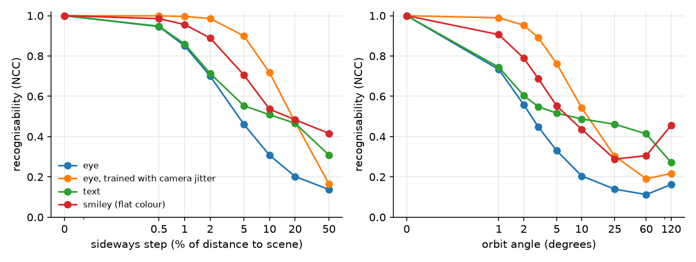

# Process log

Running record of what we tried, what happened, and why we changed course. Newest entries at the bottom.
Each entry: date, what we tried, result (with image), decision.

---

## 2026-11-24 — Entry 0: first feasibility test (T4, gsplat)

**Tried.** 40k Gaussians scattered randomly in depth (2–8 units) inside the secret camera's view frustum,
then optimized (600 Adam steps, L1) so the render from the secret camera matches a smiley + "CS180 SPLAT".

**Result.** The secret view is near-perfect (L1 ≈ 0). But the off-views at 0.15 rad and 0.6 rad are *not*
scattered specks: they show a smeared yellow blob that still reads as "a smiley seen from the side".

*Left to right: target, secret view, orbit 0.15 rad, orbit 0.6 rad.*

**Why.** Only the secret view was supervised, so the Gaussians were free to grow large and opaque;
large flat-colour regions fill a coherent cone of space, which projects to a blob from nearby views.

**Decision.** Make "what does it look like from *other* angles" the go/no-go test, not the secret view:
- cap each Gaussian's size to ~1.5 secret-view pixels at its own depth (keeps them specks);
- spread depth log-uniformly over a range much larger than the viewer's movement (3–30 units);
- only place Gaussians on "ink" pixels (targets with transparency);
- compare a flat-colour target against line art and text;
- (Illusion3D-inspired) jitter the secret camera during the fit to control the reveal-zone width.

## 2026-11-24 — Entry 1: web viewer (three.js + Spark 2.4)

**Tried.** A static viewer: fly controls, "Show me the spot" (2.5 s eased fly-to the secret pose),
a warmer/colder meter, a scene picker. Data contract: standard 3DGS PLY + `scene.json` with OpenCV
camera-to-world matrices; the viewer converts with `c2w_three = c2w_cv @ diag(1,-1,-1,1)`.

**Finding.** Browser splat renderers do not filter splats like gsplat does. Spark's default adds a
0.3 px blur *and then dims opacity to compensate*, which darkens isolated ~1 px specks by about 27%.
We switched to `preBlurAmount 0.3, blurAmount 0` (gsplat "classic" equivalent), turned off Spark's
level-of-detail (which would merge tiny specks), and stored positions at full precision. On the CPU test
scenes the secret view is crisp in the browser, and a 1M-Gaussian scene (68 MB PLY) rendered fine on a laptop.

**Decision.** Keep the classic filter so what we optimize in Python is what people see in the browser.

## 2026-11-24 — Entry 2: option A with speck-size caps (experiment A1)

**Tried.** 135k Gaussians on the eye's ink pixels, depth log-uniform in 3–30 units, each Gaussian capped
at 1.5 secret-view pixels, 1000-step fit (L1 + 0.2·D-SSIM). Variant: Illusion3D-style scheduled camera
jitter (radius ramps 0 → 0.3 units, about 3% of the viewing distance).

**Result.** Secret view SSIM 0.997. Off-views are now specks, not blobs — but the cloud reads as the
picture *extruded* into a tube, which gives the trick away from the side.
Rows: sideways steps of 0, 1, 2, 5, 10, 20, 50% of the distance / orbits of 0, 3, 10, 25, 60, 120°.

Jitter widens the reveal zone a lot (SSIM to the hidden image at a 2% step: 0.74 → 0.95; at 5%: 0.62 → 0.89),
for a tiny cost at the exact spot (0.997 → 0.96):

| sideways step | 0% | 1% | 2% | 5% | 10% | 20% |
| --- | --- | --- | --- | --- | --- | --- |
| no jitter | 1.00 | 0.81 | 0.74 | 0.62 | 0.53 | 0.46 |
| jitter 0.3 | 0.96 | 0.96 | 0.95 | 0.89 | 0.81 | 0.72 |

**Why.** To survive camera jitter the optimizer fades out specks far from the middle depth (they have
the most parallax), so the cloud flattens toward a billboard. Jitter trades *surprise* for *discoverability*.

**Decision.** (1) Fix the extrusion: only place specks where each ray passes through a *ball* around the scene
centre, so from any other angle the cloud is a round ball of coloured dust (experiment A2).
(2) Keep jitter as the reveal-zone knob and report the tradeoff as a result, not hide it.

## 2026-11-24 — Entry 3: "ball" placement, and a better reveal metric (experiment A2)

**Tried.** Instead of a fixed depth slab, each pixel ray only gets specks where it passes through a ball
around the scene centre, hoping the side views would look like a round cloud of dust.

**Result.** Barely different from the slab. From the side it still reads as streaks of the picture:

**Why (the real lesson).** Orbiting around the vertical axis never changes which *row* of the picture a
speck belongs to — rows stay rows, only their horizontal order scrambles. Any cloud built along the secret
camera's rays has this property; real anamorphic street art does too (you see coloured fragments, not noise).
Text and big flat shapes keep the most row structure, so they stay partly readable from the side.

**Metric fix.** SSIM to the hidden image stayed around 0.5 even at 120°, because the matching dark
background counts as "similar". We switched to normalised cross-correlation (NCC) over the picture's region
only: 1.0 at the secret spot, near 0 when scrambled.

| recognisability at a sideways step of | 1% | 2% | 5% | 10% | 50% |
| --- | --- | --- | --- | --- | --- |
| eye | 0.85 | 0.70 | 0.46 | 0.31 | 0.14 |
| eye, trained with camera jitter | 1.00 | 0.99 | 0.90 | 0.72 | 0.16 |

**Decision.** Stop tuning option A's look; it is the "dust cloud" baseline and the reveal-zone study.
Move to the real scene. New idea from this: *projection painting* — recolour the garden's own Gaussians by
projecting the picture from the secret viewpoint, like Felice Varini painting across buildings. From other
angles you see painted fragments on leaves, gravel and the table. That is a training-free baseline for option B,
and the starting point for its optimization.
