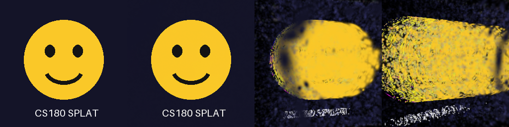

# Process log

Running record of what we tried, what happened, and why we changed course. Newest entries at the bottom.
Each entry: date, what we tried, result (with image), decision.

---

## 2026-11-24 — Entry 0: first feasibility test (T4, gsplat)

**Tried.** 40k Gaussians scattered randomly in depth (2–8 units) inside the secret camera's view frustum,
then optimized (600 Adam steps, L1) so the render from the secret camera matches a smiley + "CS180 SPLAT".

**Result.** The secret view is near-perfect (L1 ≈ 0). But the off-views at 0.15 rad and 0.6 rad are *not*
scattered specks: they show a smeared yellow blob that still reads as "a smiley seen from the side".

*Left to right: target, secret view, orbit 0.15 rad, orbit 0.6 rad.*

**Why.** Only the secret view was supervised, so the Gaussians were free to grow large and opaque;
large flat-colour regions fill a coherent cone of space, which projects to a blob from nearby views.

**Decision.** Make "what does it look like from *other* angles" the go/no-go test, not the secret view:
- cap each Gaussian's size to ~1.5 secret-view pixels at its own depth (keeps them specks);
- spread depth log-uniformly over a range much larger than the viewer's movement (3–30 units);
- only place Gaussians on "ink" pixels (targets with transparency);
- compare a flat-colour target against line art and text;
- (Illusion3D-inspired) jitter the secret camera during the fit to control the reveal-zone width.
